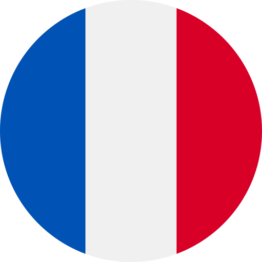
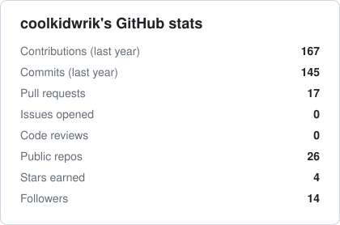
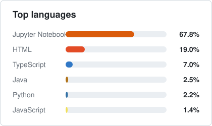

<h1 align="center"> Hi!</h1>

<!-- Github info -->

 
           
    <!----> 
    <!----> 
    <!--  -->
    
    
    

 

<!-- Intro  -->
<h3 align="center">
        <b>Hey! I'm Wrik 🇮🇳 🇸🇬 🇨🇦 </b>
</h3>

<!-- Socials  -->

  
  <!--  -->
  

 

<!-- About Section -->
## About me
 

  <!-- put spoken languages here, align right -->
  <!--https://www.flaticon.com/packs/countrys-flags-->
    <table align="right">
    <tr><td> Languages</a></td></tr>
    <tr><td><a href="README.md"> English ★★★★★</a></td></tr>
    <tr><td><a href="README_pt.md"> Hindi ★★★★★</a></td></tr>
    <tr><td><a href="README_pt.md"> French ★★★☆☆</a></td></tr>
    <tr><td><a href="README_pt.md"> Spanish ★★☆☆☆</a></td></tr>
    <tr><td><a href="README_pt.md"> Japanese ★☆☆☆☆</a></td></tr>
</table>
 I am a driven and analytical computer science student with a strong work ethic and am deeply passionate about leveraging technology to address global challenges. I firmly believe the global economy is undergoing a profound digital transformation, and I am committed to contributing to this evolution through innovation in technology. My academic journey has fueled my expertise and enthusiasm for Machine Learning, Software Engineering, Computer Vision, and Computer Graphics, with a growing interest in the transformative potential of Quantum Computing. I aspire to explore how these fields can intersect to solve complex problems and shape the future of technology.
 
  
  
 📧 &emsp; Reach out to me anytime: wriksen2003@gmail.com   
 💬 &emsp; Ask me about anything <a href = "https://github.com/coolkidwrik/coolkidwrik/issues">here</a>

 

<!-- Tech Stack -->
## 🛠 Tech I use

<!--     
    
    
    
     -->
    
    
    
    
    
    
    
    
    
    
    
    
    
    
    
    
    
    
    
    
    
    
    
    
    
    

  

<!-- Github Stats -->
## GitHub stats

  <a href="https://github.com/coolkidwrik">
<!--      -->
    <!--  -->
  </a>

  

<!-- Activity Graph-->
<!--  -->

<!-- <a> 
    
  
   
</a> -->

<!-- Generated daily by .github/workflows/stats.yml and committed to /assets -->

  
  

